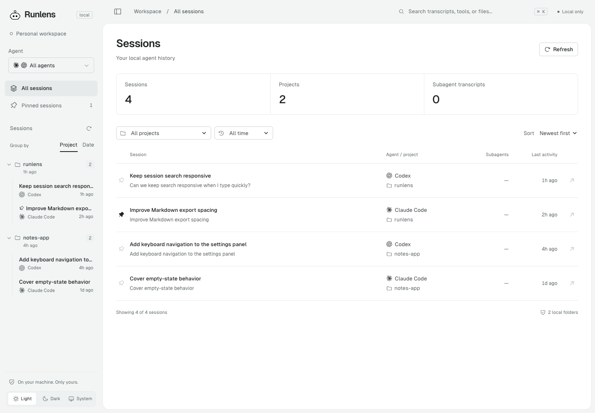
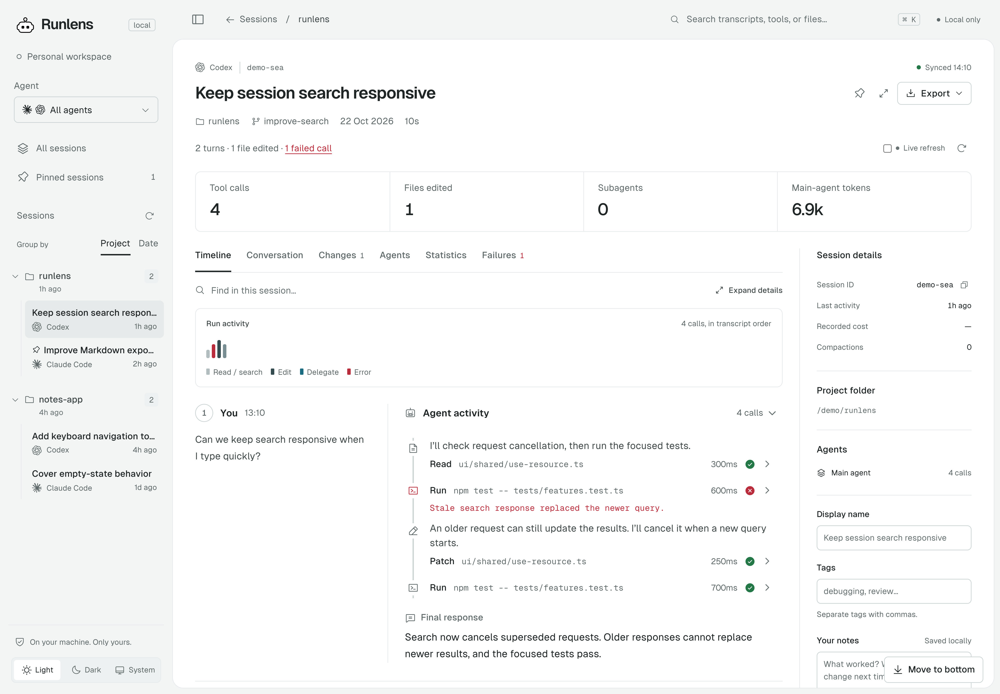

# Runlens

See what your coding agents actually did.

Runlens is a local viewer for **Claude Code and Codex** sessions. Browse conversations, inspect
commands and file changes, follow subagents, and find the step that failed. It reads the history
already on your machine. No API key, model calls, or uploads.

<picture>
  <source media="(prefers-color-scheme: dark)" srcset="docs/screenshots/library-dark.png">
  
</picture>

## Get started

Requires **Node.js 20 or newer**.

```sh
npx runlens@latest
```

Or install it globally and launch it whenever you need it:

```sh
npm i -g runlens
runlens
```

Open the local URL printed in your terminal, usually `http://127.0.0.1:8740/`.
To try changes that have not been released to npm, [run from source](docs/usage.md#run-from-source).

Runlens discovers Claude history under `~/.claude/projects`, `CLAUDE_CONFIG_DIR`, and local
`~/.claude-accounts` folders. Codex history comes from `sessions` and `archived_sessions` under
`~/.codex` and `CODEX_HOME`. [Custom folders and CLI options →](docs/usage.md)

## What you can inspect

- **Conversations and timelines:** human questions beside agent answers, with expandable tool calls.
  Move between chats in the same project with Previous/Next in the top bar.
- **File changes and failures:** recorded patches, command output, and failed calls in one session.
- **Subagents:** follow child runs and their tool activity.
- **Search and organization:** search transcripts from the centered top bar, pick an agent, group by project or date, and filter the library.
- **Your own context:** pin sessions, rename them, add tags and notes, and export Markdown or JSON.
- **Light and dark themes:** follow the system or choose either theme. Collapse the sidebar for more reading space.

<picture>
  <source media="(prefers-color-scheme: dark)" srcset="docs/screenshots/session-dark.png">
  
</picture>

Screenshots use [demo sessions](docs/screenshots/README.md), rendered by the application.

## Try it and check the results

1. Open a Claude Code or Codex session you recognize. Compare its question and response with the original.
2. Choose an agent, then switch between **Project** and **Date**. Check that the right sessions appear.
3. Open a tool call, a recorded file change, or a failed command and check its details.
4. Search for a phrase from that session. Try both themes, pin the session, and add a note.

Found something wrong? [Open an issue](https://github.com/Priyadharshan0903/Runlens/issues/new)
with what you expected, what happened, your Runlens/Node versions, and your OS. Screenshots and
small sanitized examples help. Please remove private transcript content before sharing it.
Questions and suggestions are welcome in issues; code changes are welcome through pull requests.

## Know the limits

- Local transcript formats can change, and some historical records may be unsupported. Cursor is not supported yet.
- Usage and cost appear only when recorded. **Codex tokens cover the main agent only**, so inherited fork usage is not counted twice.
- File changes describe recorded operations, not a final Git diff. A successful tool call does not prove the overall task succeeded.
- Notes and preferences stay in this browser. Transcript files are never changed. [Privacy and measurement details →](docs/usage.md)

## Let agents consult earlier work

The source preview includes a read-only MCP server with `search_sessions` and `session_summary`
for Claude Code and Codex history. Search can include a matching recorded gist and counts in one
call; summaries can filter for relevant turns. Responses default to compact excerpts. Use
`detail: "full"` for question/answer and change/failure detail, `fields` for selected turn facts, or
`max_snippet_chars` for shorter text. Connection instructions tell agents when earlier work may help.
Your agent decides when to call the tools; you can ask it directly. The client starts the server,
so the browser viewer can stay closed.

**MCP is not published to npm yet.** After a release containing MCP ships, run one of these commands
from your project folder. No source checkout, build step, or `RUNLENS_CLI` variable will be needed.
These commands do not work with the current npm release.

**Claude Code** (private configuration for this project):

```sh
claude mcp add --scope local --transport stdio runlens -- \
  npx -y runlens@latest mcp --project "$PWD"
```

**Codex**:

```sh
codex mcp add runlens -- \
  npx -y runlens@latest mcp --project "$PWD"
```

<details>
<summary>Try the unpublished source preview today</summary>

For developer testing before release, first build this checkout and capture
its CLI location in a macOS/Linux shell:

```sh
npm install
npm run check
export RUNLENS_CLI="$PWD/dist/cli.js"
```

In the **same terminal**, change into the project whose history you want, then register with one
of these clients:

**Claude Code** (private configuration for this project):

```sh
claude mcp add --scope local --transport stdio runlens -- \
  node "$RUNLENS_CLI" mcp --project "$PWD"
claude mcp list
```

**Codex**:

```sh
codex mcp add runlens -- \
  node "$RUNLENS_CLI" mcp --project "$PWD"
codex mcp get runlens --json
```

Keep the built checkout at its saved location. Choose one setup per client; review/update an existing
`runlens` registration or use a distinct server name instead of adding a duplicate.

</details>

Reconnect the client. Try: “Search Runlens for our earlier search cancellation fix. Show the session
and date, then check the recorded approach against the current code.”

`"$PWD"` captures your current folder during registration; you do not need to type its path. Access
stays fixed when you change folders. Use a distinct server name for another project or explicitly
grant it with `--allow-project` and reconnect. Agents cannot grant themselves access, and remembered
or interactive project approvals are not implemented.
MCP responses contain bounded, masked history and may reach your agent's model provider.
Search and summary pages include resumable cursors and scan progress. Large transcripts stream
across cursor pages; oversized individual records are reported as skips while later records remain
readable. Follow cursors even after empty partial pages. Summaries default to ten turns, within
the response byte cap. No model calls are made, and token savings depend on what the agent retrieves.

[Full setup, future npm commands, permissions, and limits →](docs/mcp.md)

## Contribute

```sh
npm install
npm run check
```

The check covers formatting, types, server-free tests, and the production build.
For setup, code layout, and state conventions, read the [development guide](docs/development.md)
and [AGENTS.md](AGENTS.md). New readers follow the [adapter guide](docs/source-adapters.md).

[Usage](docs/usage.md) · [Codex support](docs/codex-sessions.md) ·
[Release workflow](docs/releases.md) · [Changelog](CHANGELOG.md)

## Landing page

The public website has its own static build, separate from the local viewer:

```sh
npm run site:preview
```

Preview at `http://127.0.0.1:8741/`. Run `npm run site:build` to prepare `website-dist/` for
hosting. Deploy manually with the separate **Deploy website to GitHub Pages** workflow in Actions.
See [website development](docs/website.md) for content, animation, and one-time Pages setup.

## License

[MIT](LICENSE). Bundled libraries, fonts, and agent artwork retain their licenses in
[third-party notices](THIRD_PARTY_NOTICES.md). Claude and OpenAI marks identify supported agents;
Runlens is an independent project.
